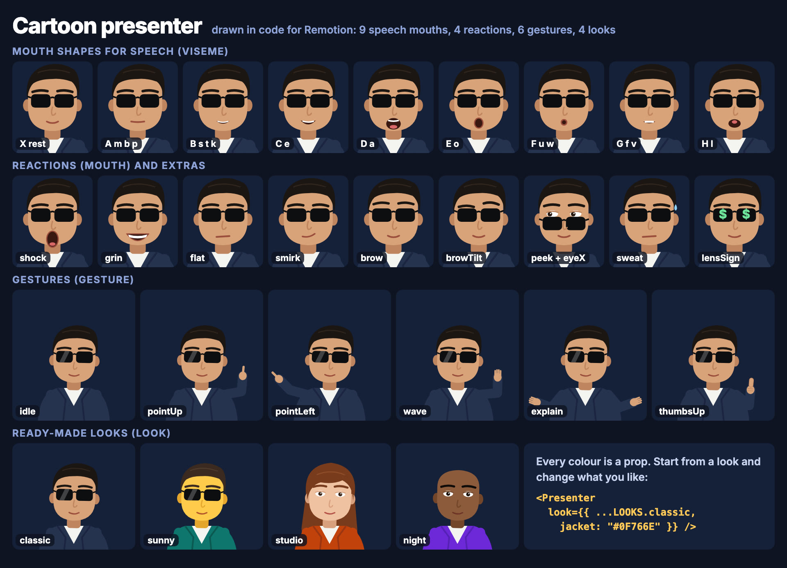
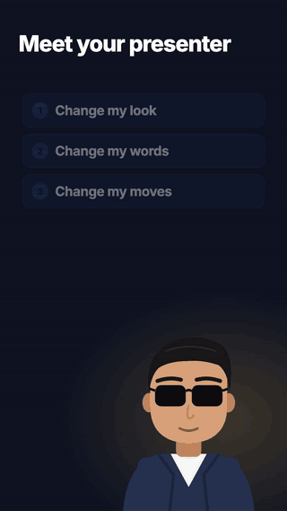

# remotion-cartoon-presenter

A cartoon presenter for your videos, drawn entirely in code for [Remotion](https://www.remotion.dev/).

He talks (the mouth follows your words), waves, points and reacts. You don't need to be on camera, and there are no image files to draw or buy: the whole character is one React component.





The example video above is silent. [Download it as an MP4](preview.mp4).

## What you get

- **Lip-sync from text.** Give it words with a start and end time and the mouth picks one of 9 shapes for every moment, based on the letters in each word. No audio analysis and no extra tools.
- **No voice-over yet?** `timeWords()` estimates the timings from a plain script, so you can build the whole video first and record later.
- **6 gestures:** idle, pointUp, pointLeft, wave, explain, thumbsUp. The arms ease from one pose to the next.
- **4 reaction mouths** (shock, grin, flat, smirk) **and extras:** raised or tilted eyebrows, sunglasses that slide down to show the eyes, a drop of sweat, a sign on the lenses.
- **4 ready-made looks.** Every colour is a setting, plus hair style and sunglasses on or off.
- **Moves tied to words.** `makeCue()` finds the frame where a phrase is spoken, so you write "wave on Hi" and not "wave at frame 15".

## Install

You need [Node.js](https://nodejs.org/) 18 or newer (tested on 24).

```bash
git clone https://github.com/umerdarazkha-debug/remotion-cartoon-presenter
```

```bash
cd remotion-cartoon-presenter
```

```bash
npm install
```

```bash
npm run dev
```

Remotion Studio opens in your browser. Pick **Example** for the talking video or **CharacterSheet** to see every mouth, gesture and look.

## Render

```bash
npm run render
```

This saves the example video to `out/example.mp4`.

```bash
npm run sheet
```

This saves the character sheet to `out/character-sheet.png`.

## Change what he says and does

Open [src/Example.tsx](src/Example.tsx) and scroll to `exampleDefaults` at the bottom:

```tsx
export const exampleDefaults: ExampleProps = {
  title: "Meet your presenter",
  script: "Hi! I'm your presenter. I'm drawn in code, so you can change my look, my words and my moves. Type a script and my mouth follows every word. No camera needed. Easy!",
  points: [
    { text: "Change my look", when: "my look" },
    { text: "Change my words", when: "my words" },
    { text: "Change my moves", when: "my moves" },
  ],
  moves: [
    ["Hi", "wave"],
    ["I'm your", "idle"],
    ["I'm drawn", "explain"],
    ["my look", "pointUp"],
    ["Type a script", "pointLeft"],
    ["No camera", "explain"],
    ["Easy", "thumbsUp"],
  ],
  peekOn: "No camera",
  wpm: 150,
  look: "classic",
  accent: "#FFC857",
};
```

- `script` is what he says. The video gets longer or shorter to fit it.
- `moves` is a list of "when he says this, do that". A phrase that is not in the script is skipped.
- `points` are the rows on the board. Each one lights up when its `when` phrase is spoken.
- `wpm` is the speaking speed in words per minute.
- `look` is `classic`, `sunny`, `studio` or `night`.

## Use him in your own video

The presenter is one component. This is the smallest version that talks:

```tsx
import React from "react";
import { useCurrentFrame, useVideoConfig } from "remotion";
import { Presenter, lipSync, timeWords } from "./Presenter";

const words = timeWords("Hello there. This is my new video.");

export const MyVideo: React.FC = () => {
  const f = useCurrentFrame();
  const { fps } = useVideoConfig();
  return <Presenter viseme={lipSync(words, (f / fps) * 1000)} gesture="wave" t={f / fps} width={420} />;
};
```

To change pose on certain words, add `makeCue`, `gestureAt` and `gestureK`:

```tsx
const { cue } = makeCue(words);
const moves: [number, "wave" | "pointUp"][] = [[cue("Hello"), "wave"], [cue("my new video"), "pointUp"]];

// inside the component
const { gesture, from, at } = gestureAt(f, moves);
<Presenter viseme={lipSync(words, (f / fps) * 1000)} gesture={gesture} from={from} k={gestureK(f, at)} t={f / fps} />
```

He is drawn 600 wide by 700 tall and scales with `width`. Place him so the bottom of the drawing sits on or below the bottom edge of your video, because the body stops at the waist.

## Add your own voice

1. Record the voice-over and put it in the `public/` folder, for example `public/voice.mp3`.
2. Get the word timings: the start and end of every word in milliseconds. Any transcription tool that gives word timestamps works. I use Whisper. Save them as `public/voice.json` in Remotion's caption format:

```json
[
  { "text": "Hi,", "startMs": 0, "endMs": 200 },
  { "text": "I'm", "startMs": 680, "endMs": 960 }
]
```

3. In [src/Root.tsx](src/Root.tsx), pass both to the example:

```tsx
import { fromCaptions } from "./Presenter";
import captions from "../public/voice.json";

<Composition id="Example" component={Example} defaultProps={{ ...exampleDefaults, audio: "voice.mp3", words: fromCaptions(captions) }} ... />
```

When `words` is set, the mouth, the speech bubble and the moves all follow the real timings and `script` is ignored. I tested this with a computer-generated voice and Whisper word timings.

## Settings

| Setting | What it does |
| --- | --- |
| `viseme` | The mouth shape for speech: `X` (rest) or `A` to `H`. Usually `lipSync(words, ms)`. |
| `gesture` | `idle`, `pointUp`, `pointLeft`, `wave`, `explain`, `thumbsUp`, or your own pose. |
| `from`, `k` | The pose to ease from, and how far along the change is (0 to 1). Use `gestureK(frame, startFrame)`. |
| `t` | Time in seconds. Drives the head bob, the wave, the glare on the sunglasses and the blinks. |
| `width` | Size in pixels. |
| `look` | Colours, hair style and sunglasses. See below. |
| `mouth` | A reaction that replaces the speech mouth for a moment: `shock`, `grin`, `flat`, `smirk`. |
| `mouths` | Your own drawings for any mouth shape. |
| `brow`, `browTilt` | Raise both eyebrows (0 to 1) or tilt them for a doubtful look. |
| `peek`, `eyeX` | Slide the sunglasses down (0 to 1) and choose where the eyes look (-1 to 1). |
| `blink` | Close the eyes (0 to 1). Leave it out and he blinks on his own. |
| `lensSign`, `lensText`, `lensColor` | Show a symbol on both lenses, `$` by default. |
| `sweat` | A drop of sweat (0 to 1). |
| `headY` | Move the head up or down. |

### Your own look

Start from a ready-made look and change what you like. The colours are `skin`, `skinShade`, `hair`, `hairShine`, `jacket`, `jacketShade`, `shirt`, `lens`, `eye`, `lip`, `mouth`, `tongue` and `teeth`. `hairStyle` is `slick`, `long` or `none`. `glasses` is `sunglasses` or `none`.

```tsx
<Presenter look={{ ...LOOKS.classic, jacket: "#0F766E", jacketShade: "#0B5850", hair: "#B45309" }} />
```

### Your own gesture

A pose is two arms. Angles are in degrees: 0 hangs down, 90 points sideways, 180 points up. `a1` is the upper arm and `a2` is how much further the forearm bends. `hand` is `open`, `point`, `fist` or `thumb`.

```tsx
const shrug: Pose = {
  L: { a1: 35, a2: 95, hand: "open" },
  R: { a1: 35, a2: 95, hand: "open" },
};

<Presenter gesture={shrug} mouth="flat" browTilt={1} />
```

### Your own mouth shapes

Pass SVG for any shape, drawn around the point `MOUTH_AT` (x 300, y 405 of the drawing):

```tsx
<Presenter mouths={{ X: <circle cx={MOUTH_AT.x} cy={MOUTH_AT.y} r={10} fill="#B5524A" /> }} />
```

To change which letters give which mouth, pass your own table as the third argument: `lipSync(words, ms, { ...LETTER_VISEMES, s: "C" })`.

## With Claude Code

You don't have to write the code yourself. Open [Claude Code](https://claude.com/claude-code) in this folder and say:

```
Make a 20-second vertical video where the presenter from src/Presenter.tsx explains my 3 pricing plans. Give him a green jacket, make him wave at the start and give a thumbs up at the end.
```

## Good to know

- **The lip-sync is a guess from spelling.** It reads the letters of each word, not the sound. That is enough for a cartoon, but it is not frame-accurate like studio animation.
- **Latin letters only.** Words written in other scripts (Arabic, Urdu, Hindi and so on) leave the mouth at rest. Timings still work, so a mouth table for another script could be added.
- **No sound included.** The example and the preview are silent until you add your own voice-over.
- **One view.** He faces the camera and is drawn from the waist up. He does not walk or turn.
- **The example is 1080x1920 at 30 frames per second.** The presenter itself scales to any size.
- **Font.** The text uses Inter, loaded from Google Fonts, so the first render needs an internet connection.
- **Remotion's licence.** Remotion is free for individuals and small teams and paid for larger companies. Check [remotion.dev/license](https://www.remotion.dev/license) before using it at work.

## Credit

The idea of a small cartoon host in the corner of an explainer video came from a reel I saw for a product called Dock. This character is my own: it was drawn from scratch in code with Claude Code, uses none of that video's files and looks different.

The mouth shape names (`A` to `H` and `X`) follow the convention used by [Rhubarb Lip Sync](https://github.com/DanielSWolf/rhubarb-lip-sync). No Rhubarb code is used here.

## License

MIT. Use it, change it, share it.

Built by [Umer Daraz Khan](https://github.com/umerdarazkha-debug) with Claude Code. More at [@umer.does.ai](https://www.instagram.com/umer.does.ai/) and [YouTube](https://www.youtube.com/@umerdoesai).
